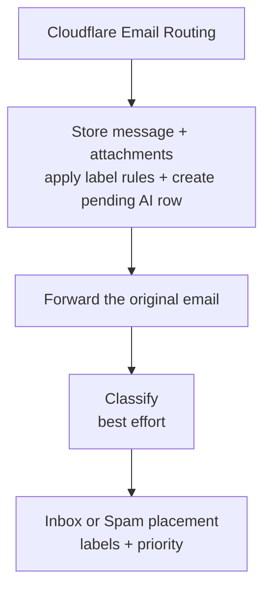
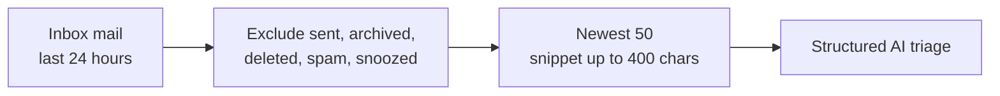
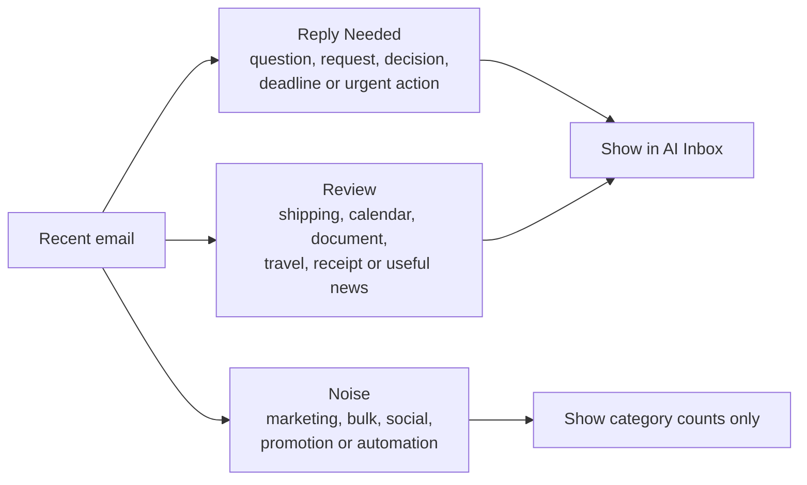

Cookie's AI features are deliberately narrow: each one assists a specific, familiar task rather than acting autonomously on the user's behalf. The full design rationale lives in Cookie-Web's `docs/AI-CAPABILITIES-REPORT.md`; this page explains what's shipped and how the pieces work together.

| Capability | Component | Model/API |
| --- | --- | --- |
| Auto-tagging | `mail-app-ingest` (Cookie-Worker) | OpenAI structured response |
| Spam detection | `mail-app-ingest` (Cookie-Worker) | Same structured response as auto-tagging |
| Federated search (mail, documents & tasks) | `cookie-web-search` (Cookie-Worker) | Meilisearch hybrid/federated search |
| Assistant chat (mail, documents & tasks) | `cookie-web-search` (Cookie-Worker) | Meilisearch conversational search, OpenAI chat model |
| Mailbox Q&A (`POST /ask`, legacy) | `cookie-web-search` (Cookie-Worker) | OpenAI Responses API |
| AI Compose | `cookie-web-ai` (Cookie-Worker) | OpenAI Responses API |
| Writing suggestions in the composer | `cookie-web-ai` (Cookie-Worker) | OpenAI Responses API, no reasoning pass |
| Document chat and editing | `cookie-web-ai` (Cookie-Worker) | GPT-6.1 Sol via OpenAI Responses API |
| Reading-view summaries | `cookie-web-ai` (Cookie-Worker) | OpenAI Responses API |
| Natural-language calendar drafts | `cookie-web-calendar` (Cookie-Worker) | OpenAI Responses API |
| Link-only unsubscribe assistance | `cookie-web-messages` (Cookie-Worker) | OpenAI Responses API |
| AI Today: inbox triage | `data-enricher` (Cookie-Worker) | OpenAI Responses API |

## Models

Every model is an OpenAI model called with the one `OPENAI_API_KEY` each Worker holds. The defaults below were chosen on 2026-11-15 as the newest model in the cheapest tier that does each job; prices are OpenAI's standard rates in USD per million input / output tokens on that date.

| Used for | Default model | Price | Override |
| --- | --- | --- | --- |
| Mail classification on arrival | `gpt-6-luna` | 0.10 / 0.50 | `AI_MODEL` on `mail-app-ingest` |
| Compose, summaries, new documents, rule drafts | `gpt-6-luna` | 0.10 / 0.50 | `OPENAI_COMPOSE_MODEL`, `OPENAI_SUMMARY_MODEL`, `OPENAI_DOCUMENT_MODEL` |
| Writing suggestions in the composer | `gpt-6-luna`, no reasoning pass | 0.10 / 0.50 | `OPENAI_COMPOSE_MODEL` |
| Calendar and task drafts, unsubscribe assistance | `gpt-6-luna` | 0.10 / 0.50 | `OPENAI_CALENDAR_MODEL`, `OPENAI_UNSUBSCRIBE_MODEL` (task drafts have none) |
| AI Today triage | `gpt-6-luna`, or `gpt-6.1-terra` (1 / 5) when chosen in Settings | 0.10 / 0.50 | Settings → AI Today |
| Document chat | `gpt-6.1-sol` | 2 / 10 | `OPENAI_DOCUMENT_CHAT_MODEL` |
| Mailbox Q&A (`POST /ask`, legacy) | `gpt-6-luna`, no reasoning pass | 0.10 / 0.50 | `OPENAI_ASK_MODEL` |
| Assistant chat | `gpt-4o-mini` | 0.15 / 0.60 | `OPENAI_CHAT_MODEL` |
| Search embeddings | `text-embedding-3-small` | 0.02 / n/a | none: changing it means re-embedding every index |

The assistant chat is the one feature still on an older model, and it has a deadline: OpenAI removes `gpt-4o-mini` on 2027-01-14. The chat runs inside Meilisearch, which calls OpenAI's Chat Completions API with a search tool. The GPT-5.6 and GPT-6 models accept tools there only with `reasoning_effort` set to `none`, and Meilisearch (checked through 1.56.2) rejects that value before the request leaves it, so each of those models fails with "Function tools with reasoning_effort are not supported". Before the deadline, either upgrade to a Meilisearch release that forwards `none` and set the default to `gpt-6-luna`, or set `OPENAI_CHAT_MODEL` to `gpt-5.4-mini` (0.75 / 4.50), the newest model that works there today.

AI Today settings saved with a model that has since been retired (`gpt-5-nano`, `gpt-5.6-luna`, `gpt-4.1-nano`) read back as the default, so no data change is needed when the list moves on.

## What “AI Inbox” means

AI Inbox is Cookie's normal mailbox with assistance layered around it — not a second mailbox and not an autonomous email agent. New inbound mail is classified automatically; summaries, mailbox Q&A, and draft generation run only when the user asks for them. Writing suggestions are the one feature that runs as the user works: while a message is being written, the composer asks for the likely next words at each pause, unless that is switched off in Settings. Nothing in the AI path replies, sends, or deletes mail by itself.

| When | What runs | Result |
| --- | --- | --- |
| When mail arrives | Deterministic label rules, AI classification, spam scoring, and priority | Labels and Spam placement update; the message becomes available to search |
| When the user asks | Search, the assistant chat, a thread summary, or AI Compose | A result or draft is returned to the authenticated client |
| While the user writes a message | Writing suggestions | The likely next words are shown in grey after the caret; they join the message only if the user presses Tab |
| Saved schedule or on refresh | AI Today triage | Recent-inbox triage is stored for AI Today; news and task extraction do not run |

## What happens when mail arrives



### 1. Store first, with deterministic rules

`mail-app-ingest` parses the message and stores it idempotently through Hyperdrive. The same database transaction creates a durable `message_ai` row with `status = 'pending'` and evaluates the user's enabled conditions rules.

Conditions rules are deliberately separate from AI: they compare `subject`, `body`, `from`, or `to` using exact `contains`, `equals`, `starts_with`, or `ends_with` conditions. A matching rule writes a label with `source = 'rule'` (or marks the message done); because this happens inside the storage transaction, there is no confidence threshold or recovery job.

A rule can instead be defined by a plain-language prompt (`label_rules.kind = 'ai'`, migration `0068`), such as "receipts and order confirmations from online shops". Those prompts are not evaluated here: the classifier in step 3 receives them alongside the auto-tag labels and reports which rules the message matches, with the same 0.70 confidence bar. A matched AI rule applies its label with `source = 'ai'` and `rule_id` provenance, or marks the message done.

The original email is then forwarded to the real mailbox. Delivery is the primary outcome: storage, attachment upload, AI, and monitoring failures never intentionally make the model a dependency of forwarding.

### 2. Classify the message

Best-effort enrichment uses a fresh database client rather than holding the ingest connection open during model latency. It runs a single classification request, and the result is saved once the model responds.

The classification request contains:

- the sender address, subject, and up to **12,000 characters** of plain-text body;
- only user labels whose **Auto-tag** switch is enabled, including each label's ID, name, and description;
- a system instruction that treats the email as untrusted data, never as instructions.

The OpenAI response is constrained to a strict JSON schema containing candidate label IDs and confidences, a spam verdict/score/reason, a `low`/`normal`/`high` priority, and a `paper_trail` flag for receipts, confirmations and other transactional records. The default model is `gpt-6-luna` (overridable with `AI_MODEL`), and the stored prompt version is `email-enrichment-v6`.

:::note
Arrival-time enrichment never generates a message summary. Reading-view summaries are a separate, authenticated, user-triggered operation.
:::

### 3. Apply local policy after the model responds

Cookie-Worker does not write the model response directly. It applies deterministic checks first:

| Model output | Local decision | Effect |
| --- | --- | --- |
| Label candidates | Keep only IDs offered to the model with confidence **≥ 0.70** | Replace prior `source = 'ai'` labels; preserve manual and rule-applied labels |
| A `spam` verdict below **0.80** | Treat as Inbox | No automatic move |
| A `spam` verdict from **0.80** to below **0.98** | Store as internal `review` | Message remains in Inbox |
| A `spam` verdict **≥ 0.98** | Confirm as Spam | Apply the system Spam label, hide from Inbox and unread counts, show under **More → Spam** |
| `low` / `normal` / `high` priority | Store on `message_ai` | Used for mailbox priority; AI Today does not run per-email task extraction |
| `paper_trail` is true | Skip when the message is confirmed Spam | Apply the system Paper Trail label as a `source = 'ai'` label; the message stays in Inbox and also appears under **Paper Trail** in the sidebar |

Every completed classification stores the provider, model, prompt version, processing time, spam reason, and label confidence. That provenance makes later prompt/model changes auditable. A retry deletes and rebuilds only AI-applied labels, so manual labels and deterministic rule results remain intact.

### 4. Recover partial failures

The `message_ai` row records `pending`, `completed`, or `failed` state. Every 15 minutes, `mail-app-ingest` selects up to three of the oldest rows that have been stale for at least two minutes and still need classification, and retries it.

Recovery never re-forwards a message and never changes the fact that it was delivered. It only repairs the optional AI layer.

One failure is expected and is left to recovery on purpose. OpenAI answers `403 unsupported_country_region_territory` when the email being handled was delivered by a mail server in a region it does not serve, such as Hong Kong or mainland China, wherever the Worker itself runs. Every attempt made while handling that email is refused, so the email handler tries once, logs `ai_enrichment_deferred` and reports nothing to Sentry. The recovery pass is not triggered by any sender and classifies the message on its next run, up to about 15 minutes later. The same refusal met during recovery is reported as an error.

### 5. User controls and current limits

In **Settings → Labels**, the user can enable or disable Auto-tag independently for each user label. Descriptions help the classifier distinguish similarly named labels, while manual labels and deterministic rules remain available when Auto-tag is disabled.

In **Settings → Rules**, a rule's matcher is either conditions or a Cookie AI prompt ("Match by"). Prompt rules describe the mail in plain language and can apply a label or mark mail done; they run with AI auto-tagging rather than at storage time, so they inherit its confidence threshold and retry sweep.

Spam is stored in the Spam folder and deleted after the retention set in **Settings → Spam** (30 days by default), and the high threshold deliberately favours false negatives over hiding legitimate newsletters or receipts. There is not yet a **Not spam** feedback action, sender allow-list, or training loop; those are not implied by the AI Inbox label.

## Search and the assistant chat

`GET /search`, served by the `cookie-web-search` Worker, queries Meilisearch directly. Without `scope`, it preserves the mail-only response contract; `scope=all|mail|documents|tasks` runs the unified search page's federated query. Meilisearch blends keyword and semantic matches via its `semanticRatio`, so embedding computation and ranking fusion are handled by Meilisearch. Mail filters (`tag:`, `sender:`, `to:`, `has:attachment`, `before:`, `after:`, `in:`), document tags/starred state, and incomplete task documents are applied per index. Subtask titles are indexed with their top-level task. Header typing and Enter both use hybrid search; explicit `mode=keyword` requests set `semanticRatio: 0`. Mail searches include archived messages by default and exclude deleted messages, while explicit `in:` filters retain their folder-specific behavior. Mail ranking uses recency only as the final relevance tie-breaker, tighter typo matching, and a 0.5 ranking-score threshold for text queries (not filter-only queries). Meilisearch is a hard dependency: an outage returns an error instead of falling back to Postgres.

The **AI chat** button at the right of the header (beside the calendar button, on every app) opens the **Cookie Assistant** drawer, which is also what the search page's "Ask the assistant" opens. A question goes to `POST /chat` on the `cookie-web-search` Worker, which hands the conversation to Meilisearch's conversational search (the experimental `/chats` route). Meilisearch gives the model one search tool over the `messages`, `documents` and `task_items` indexes, runs each search the model asks for as a hybrid query with that index's `chat` settings (a description of what the index holds, a template that renders a hit for the model, five hits per search), and streams the answer back. While it works the drawer says what it is searching ("Searching mail…"), and the answer ends with chips for the items it drew on; a document chip opens that document. When the answer enumerates emails (a numbered or bulleted list citing two or more messages), those messages also appear in the inbox list as search results, with the question as the search label: the rows come from `GET /search?ids=` on `cookie-web-search` in the same shape as any search hit, clearing the search restores the inbox, and the drawer brings the inbox into view if another app is showing. The conversation continues for as long as the drawer is used: every turn resends the earlier questions and answers together with the search calls and results Meilisearch hands back, because the endpoint keeps no state.

The boundary stays in the Worker. It verifies the Auth0 token, spends the shared AI quota (ten questions a minute per user, the same scope as the other AI routes), adds today's date for the model, and signs a five-minute Meilisearch tenant token whose search rules pin every index to `user_id = <owner>` (and mail to what search shows, not deleted). Meilisearch applies those rules to every search the model makes, so a filter the model writes can narrow a search but never reach another person's rows. The browser never holds a Meilisearch credential and never chooses the model. The workspace settings (the OpenAI model called through the same Cloudflare AI Gateway as the other Workers, the system prompt that treats everything inside mail, documents and tasks as untrusted text) live in the Worker and are pushed to Meilisearch by it. Setup and failure signals are in Cookie-Worker's RUNBOOK ("Assistant chat").

`POST /ask` provides single-question mailbox Q&A on the same Worker for clients that use this endpoint: it retrieves owned mail from Meilisearch itself and asks the model to answer with cited messages. Cookie-Web does not call it.

## Reading-view summaries

`POST /summarize` on `cookie-web-ai` accepts only an owned message ID. The Worker resolves the complete thread server-side, orders it chronologically, and sends a bounded transcript to the Responses API. The current limits are 50 messages per thread, 20,000 body characters per message, and 100,000 characters for the assembled transcript; an oversized thread is rejected rather than silently summarized from partial context.

The resulting summary is saved to the selected message's `message_ai.summary` field and restored when the reader is reopened. The upsert changes only the summary, so it cannot overwrite classification status, spam state, priority, or provenance.

## AI Compose

`POST /compose` on `cookie-web-ai` accepts a user instruction, the current composer state, and an optional owned message ID for reply context — it fetches that context server-side rather than trusting whatever the browser sends. It returns a subject/body draft only:

:::note
Generation never calls Resend. The user must explicitly review, edit, and send the draft through the normal send path — in both Cookie-Web and Cookie-iOS.
:::

## Writing suggestions

While a message is being written in Cookie-Web, the composer and the reply box suggest the words most likely to come next, shown in grey after the caret with a small **Tab** marker. Pressing Tab (or clicking the grey words) writes them into the message; typing anything else ignores them. [Cookie-Web's writing suggestions section](/components/cookie-web#writing-suggestions) describes the behaviour in the editor.

`POST /compose-suggest` on `cookie-web-ai` takes the message up to the caret (`text`, of which the last 1,500 characters are used) and, as optional context, the recipient line, the subject and an owned message ID for a reply. As with AI Compose, the original message of a reply is fetched server-side, only when it belongs to the caller and is not held by screening, and at most its first 2,000 characters are sent. The answer is `{ "suggestion": "…" }`: the exact characters to insert, on one line and at most 120 characters, or an empty string when the model has nothing likely to offer. The Worker removes a leading space where the text already ends in one and drops words the model repeated from the current line.

Three things keep the feature quick and cheap:

- **No reasoning pass.** The call sets `reasoning.effort` to `none` and times out after four seconds; a suggestion that arrives after the writer has moved on is thrown away.
- **A quota of its own.** The composer asks at every typing pause, far more often than the click-driven AI routes, so the route claims its own rate-limit scope (`compose-suggest`, 30 requests a minute per user) and typing cannot use up the allowance that drafts and summaries share. Over the limit the Worker answers 429 and the composer stops asking for a minute.
- **Small requests.** Estimated from the character limits above, a request is at most about 1,400 input tokens and 100 output tokens, under 0.0002 USD at `gpt-6-luna`'s rates, and usually a fraction of that. The quota therefore caps an hour of continuous typing at about 0.35 USD. This is the only AI cost that scales with typing, and it is zero when the feature is switched off (Settings → Signature → Writing suggestions).

Nothing is stored: the suggestion is not saved, and it is not part of the draft unless accepted. The text before the caret does leave the browser for OpenAI at each pause while the feature is on, which is why the Settings switch says so.

## AI Today

Read through `cookie-web-tasks`'s `GET /tasks`; only inbox triage is rebuilt by `data-enricher`:

- **Today's Events** — the day's calendar events from `GET /calendar-events`, shown only when there is at least one, each opening in Calendar. This is a read of the calendar Worker, not an AI feature; see [Today's events in AI Today](/components/cookie-web#todays-events-in-ai-today).
- **Suggested to-dos** — Cookie's own Tasks due today or overdue (the same `task_items` the Tasks app edits, served by `cookie-web-tasks`) plus stored extracted action items from important mail, most-pressing first. The enricher does not extract tasks. Completing or rescheduling one here updates it in the Tasks app.
- **Email triage** — Inbox mail from the last 24 hours, plus mail marked done in that time, divided into **Reply Needed**, **Review**, and **Noise**, rebuilt on the saved Europe/London schedule (default hourly, 09:00–19:00 daily) or on demand. Recently done mail stays listed, ticked, rather than disappearing from the day's triage.
- **News round-up** — existing stored snapshots remain readable. The enricher does not fetch feeds, rank news, or write news snapshots.

`POST /tasks/refresh` calls `data-enricher`'s `POST /run?phase=today` over the `ENRICHER` service binding, carrying the shared trigger token and enforcing the configured owner before the triage-only rebuild. The legacy `digest` alias and a request without a phase also run only triage. News and per-email task extraction are excluded from every trigger.

## Calendar interpretation

`POST /calendar-events` with `action: "interpret"` turns natural language plus an IANA time zone into a bounded event draft. The browser or iOS client must show and explicitly submit that draft in a second create request; interpretation alone never writes a calendar row. The route shares the durable per-user AI rate limit.

## Link-only unsubscribe assistance

`cookie-web-messages` prefers RFC one-click and `mailto:` unsubscribe mechanisms. For a sender that exposes only a web page, the optional AI tier reads sanitized, size-bounded page HTML, proposes at most one form submission, and judges the returned page for a clear confirmation. Page text is untrusted: code validates the public HTTPS target, redirect chain, related host, fields, values, byte limits, and end-to-end deadline before the model's proposal can cause a request. Login, CAPTCHA, JavaScript-only, or ambiguous flows stop without claiming success.

### How email triage chooses what to show

Cookie adapts the policy from [Eric Porres's Email Triage Plugin](https://github.com/ericporres/email-triage-plugin). The plugin is a Claude/Gmail workflow, so Cookie does not install or execute it in production. `data-enricher` implements its useful decision rules directly with Cookie's existing OpenAI structured-response and Postgres pipeline.

The candidate scan is intentionally based on time, not unread state. Opening an email is not proof that its request has been dealt with.



For each candidate the model receives the sender, delivery address, subject, timestamp, and a bounded snippet. The delivery address can reveal an alias or role address; when it does not, the decision falls back to sender and content. Full bodies and threads are not loaded for this background scan.

The model must place every supplied message ID into exactly one tier:



- **Reply Needed** shows a one-line summary and a suggested next action.
- **Review** shows why the message deserves attention even when no reply is needed.
- **Noise** never becomes an email row. Cookie counts it locally by category and shows only the summary.

Cookie validates the response after the model call. An unknown ID, duplicate ID, or missing candidate rejects the triage run instead of silently hiding mail. The stored record keeps the legacy `daily_digest` kind and `topics` field so Cookie-Worker and Cookie-Web remain safe to deploy in either order; it also records `email-triage-v2` and the policy source for provenance.

Triage is a view, not a mailbox mutation. It never sends, archives, or deletes anything. `cookie-web-tasks` rechecks cited message IDs against live mailbox state before rendering: it drops messages deleted or rescheduled since the snapshot, keeps messages marked done within the last 24 hours as done rows (using `messages.archived_at` from migration `0092`), and drops mail done longer ago. The model is told which candidates are already done so the overview can mention what has been handled. Clicking **Mark all emails as read** or a row's **Mark done** is still an explicit user action.

## Safety boundaries

- **Forwarding first**: in `mail-app-ingest`, storage, classification, and monitoring failures never intentionally block mail delivery.
- **Server-trusted context**: AI Compose and reply context are fetched server-side, never trusted from the client. Writing suggestions load reply context the same way.
- **Constrained egress**: AI unsubscribe can submit only a validated form to a related public HTTPS host; arbitrary model-selected requests are rejected.
- **Bounded automation**: AI never sends or deletes mail. Only a spam verdict at or above `0.98` changes folder placement automatically; each label's `auto_apply` setting independently controls whether AI may apply it.
- **Rate limits**: `0039_api_rate_limits.sql` gives AI and enricher requests durable, per-user Postgres counters shared across serverless instances — see [Data model](/data-model#rate-limits).
- **Sanitised error reporting**: `mail-app-ingest` reports failures to Sentry without email or model content (`sentry.js`).


## Document AI chat

The **AI** button opens a right-hand conversation panel in Documents. Send a question or describe a change; each request includes the latest editor snapshot (including recent unsaved typing), the current instruction, and up to 12 recent conversation messages. From the document dashboard the same panel works without an attached document.

```mermaid
sequenceDiagram
    participant Editor as Cookie-Web editor
    participant AI as cookie-web-ai
    participant DB as Postgres
    participant Model as OpenAI
    Editor->>AI: POST /document-chat (instruction, draft, history)
    AI->>DB: Verify user and document ownership; enforce quota
    AI->>Model: GPT-6.1 Sol, full draft, structured response
    Model-->>AI: Reply and optional proposed changes
    AI-->>Editor: Validated reply and preview
    Note over Editor: User chooses Apply changes or Create document
    Editor->>DB: Normal autosave through cookie-web-tasks
```

Document chat defaults to `gpt-6.1-sol` with medium reasoning, independently configurable through `OPENAI_DOCUMENT_CHAT_MODEL`. [OpenAI describes it as a model for complex coding, computer use and professional work with a 1,050,000-token context window and structured outputs](https://developers.openai.com/api/docs/models/gpt-6.1-sol). Cookie imposes smaller application limits: a 1 MiB request body, 250,000 document characters, 500 blocks, an 8,000-character instruction, a 90-second model deadline, and 16,000 output tokens. Oversized drafts and incomplete responses are rejected, not silently truncated.

Questions return an answer; editing instructions return a proposed document with **Preview changes** and **Apply changes**. The server never writes the proposal itself. Before applying, the client checks that the document still matches the draft used for the request; a changed draft requires a new suggestion. Accepted edits use the existing autosave and conflict-recovery flow. With no document attached, **Create document** saves the proposal as a new page.

Images, drawings, spreadsheets and other non-text blocks must be preserved exactly by references to the original blocks. Model-generated text is converted from escaped Markdown into supported Editor.js blocks. Linked files and image pixels are not fetched or visually analysed. The request uses OpenAI `store: false`; chat history is held in the browser view and cleared when changing documents. Failed requests keep the typed instruction available for retry.
