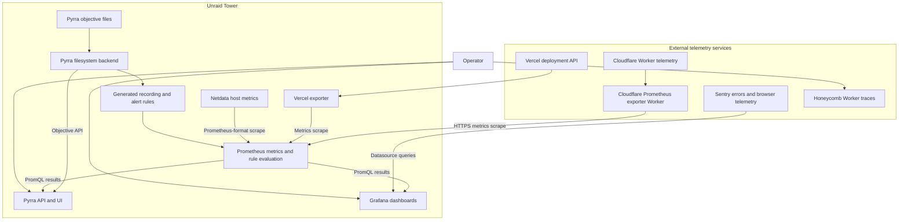
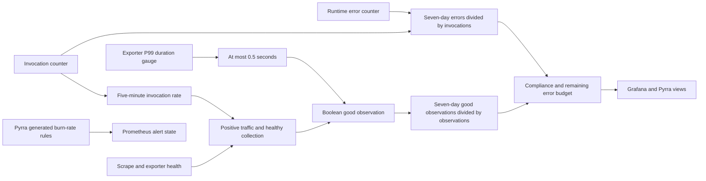
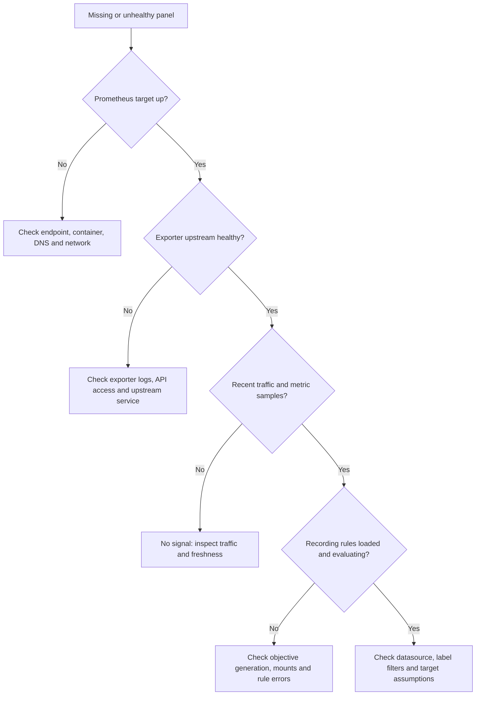

The internal monitoring environment runs on Unraid Tower. Prometheus collects and stores metrics, Pyrra translates service-level objectives into Prometheus rules, and Grafana presents those results alongside external application telemetry. Netdata supplies host metrics. Application-side errors and traces also flow to Sentry and Honeycomb; request and query timings are recorded in Analytics Engine.

## Architecture and boundaries



Arrows represent data or configuration flow. Prometheus initiates metric scrapes; Grafana and Pyrra query Prometheus. Grafana is a presentation layer, not the metrics store. Pyrra generates rules; Prometheus evaluates them. Honeycomb traces remain outside this metrics pipeline.

The core services use the Docker network `grafana_default`. Grafana's Worker dashboards explicitly select the `tower-prometheus` datasource, which addresses `http://prometheus:9090`; the default Grafana datasource is Sentry. When using Explore, select Prometheus explicitly.

## Services and access

| Service | Role | Access |
| --- | --- | --- |
| `grafana` | Dashboards and external datasource queries | Tower loopback and Tailscale address, host port `3007` to container `3000` |
| `prometheus` | Scrapes, time-series storage, recording rules and alert evaluation | Tower loopback and Tailscale address, port `9090` |
| `pyrra` | SLO API and UI | Tower loopback and Tailscale address, port `9099` |
| `pyrra-filesystem` | Reads objectives and generates rules | Internal API at `http://pyrra-filesystem:9444` |
| `vercel-exporter` | Vercel deployment/build metrics | Internal endpoint `http://vercel-exporter:9108/metrics` |
| `netdata` | Host resource telemetry | Scraped on Tower's LAN address, port `19999` |

For private access use `http://tower-1.taild247d7.ts.net:3007`, `:9090` or `:9099` from an authorised Tailscale client. Loopback URLs refer to Tower, not the operator's laptop.

Grafana also lists a second Prometheus datasource (`prometheus-1`), an Alertmanager datasource and a Netdata Cloud datasource. Registration alone does not prove those integrations are healthy or used by a particular dashboard.

## Collection and retention

| Prometheus job | Target | Interval | Purpose |
| --- | --- | --- | --- |
| `cloudflare-workers` | HTTPS `/metrics` on `cloudflare-prometheus-exporter.cloudflare-581.workers.dev` | 30 seconds | Worker invocation counts, runtime errors and duration percentiles |
| `vercel-cookie-web` | `vercel-exporter:9108/metrics` | 60 seconds, 45-second timeout | Project deployment/build telemetry |
| `tower-netdata` | `192.168.1.123:19999/api/v1/allmetrics?format=prometheus` | 30 seconds | Tower host metrics |
| `prometheus` | `localhost:9090/metrics` | 30 seconds | Prometheus's own runtime metrics |

The global rule evaluation interval is 30 seconds. Prometheus uses retention limits of **15 days** and **10 GB**; either limit can constrain available history. Seven-day SLO calculations require sufficient retained samples.

`up{job="cloudflare-workers"}` reports scrape success. `cloudflare_exporter_up` reports the exporter's upstream collection state. Check both: an HTTP endpoint can respond successfully while its upstream telemetry collection has failed. A healthy scrape also does not independently prove that every exported value is fresh.

## Persistent configuration and data

| Tower path | Container use | Ownership and recovery significance |
| --- | --- | --- |
| `/mnt/apps/appdata/prometheus/config/prometheus.yml` | `/etc/prometheus/prometheus.yml`, read-only mount | Scrape jobs, intervals and rule-file references |
| `/mnt/apps/appdata/prometheus/config/cloudflare-late.yaml` | `/etc/prometheus/cloudflare-late.yaml` | Derived latency, traffic and error recording rules |
| `/mnt/apps/appdata/prometheus/data` | `/prometheus`, writable | Historical metric samples |
| `/mnt/apps/appdata/pyrra/objectives` | `/etc/pyrra` in filesystem backend, read-only | Authoritative SLO definitions |
| `/mnt/apps/appdata/pyrra/rules` | Writable backend output; read-only `/pyrra-rules` in Prometheus | Generated recording and alert rules |
| `/mnt/apps/appdata/grafana/data` | `/var/lib/grafana`, writable | Grafana's saved state |
| `/mnt/apps/appdata/grafana/provisioning/datasources` | `/etc/grafana/provisioning/datasources`, read-only | Provisioned datasource configuration |

Prometheus loads `/pyrra-rules/*.yaml` and `/etc/prometheus/cloudflare-late.yaml`. Preserve objective files as source configuration; hand edits to generated rules can be overwritten. Preserve the existing `/pyrra-rules` mount when recreating Prometheus.

Back up persistent configuration and state using a consistent database/filesystem backup procedure. Configuration recovery restores collection and definitions; restoring metric history requires the Prometheus data as well. Keep API credentials out of documentation, dashboard exports and source control.

## How SLOs are calculated

There are 34 objective files covering 17 Workers, including the exporter and `northlink-automation` as well as Cookie services. This inventory is broader than Cookie's application Worker list.



### Reliability

The ratio indicator uses `cloudflare_worker_errors_total` over `cloudflare_worker_requests_total`, filtered by Worker and grouped by account. Reliability is `1 - errors / invocations`. The `cookie-web-emails` objective targets **99.9% over seven days**.

This measures invocations completing without Cloudflare runtime errors. It does not establish HTTP success, reachability, delivery correctness or execution of a missed scheduled job. No invocations means there is no request-based result.

### Latency

`cloudflare_worker:duration_p99_seconds` selects the exporter's `quantile="P99"` gauge. `cloudflare_worker:latency_p99_good` records whether that value is at most **500 ms**, only where five-minute invocation rate is positive and both collection health checks pass.

The latency objective targets **99.9% good active observation intervals over seven days**. It is not a statement that 99.9% of individual requests finished within 500 ms. Each included evaluation contributes an observation rather than a request count; low-traffic and high-traffic intervals are not weighted by their request volumes. The duration units follow the exporter's metric contract.

### Ingestion targets

The `mail-app-ingest` reliability objective targets **95%**, while its latency objective targets **99.9%**. Use the objective's label filters when querying its metrics.

The Grafana Worker dashboard uses a uniform 99.9% target and divides reliability error ratios by `0.001` for budget calculations. This differs from ingestion's 95% reliability target. Use Pyrra's objective-specific results to interpret ingestion's error budget.

For any objective, remaining budget is `1 - bad_fraction / (1 - target_fraction)`. Negative remaining budget means the allowance has been exceeded. A missing denominator or absent signal must remain unknown, rather than being presented as perfect compliance.

## Dashboards and alerts

| Dashboard UID | Use |
| --- | --- |
| `cookie-app-overview` | Cross-source Worker, Sentry and Vercel overview |
| `cookie-workers-slos` | Worker status, compliance, error budgets, traffic, errors and P99 duration |
| `cookie-web-sentry` | Frontend issues and performance |
| `cookie-web-vercel` | Vercel deployments and builds |

The Vercel dashboard explicitly states that runtime observability is unavailable on the current plan. Prometheus has no Sentry exporter scrape job; Sentry telemetry is queried through its Grafana datasource.

The Pyrra objectives enable burn-rate alerts and disable absent-series alerts. The Worker dashboard counts `ALERTS` with `alertname="ErrorBudgetBurn"` and `alertstate="firing"`. That proves what the panel queries, not that a notification reaches an operator.

The Prometheus configuration contains no `alerting` destination block. Although Grafana has an Alertmanager datasource, this does not establish a Prometheus-to-Alertmanager notification route. Notification delivery requires a configured alert route and receiver. A Tower outage also removes this monitoring stack's own view of the incident; it is not an independent external availability monitor.

## Operational checks



Start with Prometheus `/targets`, `/rules` and `/alerts`. Useful Explore queries against `tower-prometheus` include:

```text
up
cloudflare_exporter_up{job="cloudflare-workers"}
cloudflare_worker:requests_per_second:rate5m
cloudflare_worker:error_ratio:rate5m
cloudflare_worker:duration_p99_seconds
ALERTS{alertname="ErrorBudgetBurn",alertstate="firing"}
```

Run the following read-only configuration checks on Tower after a monitoring change:

```sh
docker exec prometheus promtool check config /etc/prometheus/prometheus.yml
docker exec prometheus sh -c 'promtool check rules /pyrra-rules/*.yaml /etc/prometheus/cloudflare-late.yaml'
curl -fsS http://127.0.0.1:9090/-/ready
curl -fsS http://127.0.0.1:9090/api/v1/targets
```

For an SLO change, edit the objective source, confirm backend generation, validate the generated rules, and confirm Prometheus loaded the expected expressions. Then compare Pyrra with Grafana using the same target, time window and label filters. A file on disk, a successful reload and a rendered panel are separate checks.

For a telemetry outage, restore collection before interpreting budgets. For an application failure with healthy telemetry, inspect Sentry issues filtered by service, the corresponding Worker traces in Honeycomb, and the platform logs for the affected deployment.
